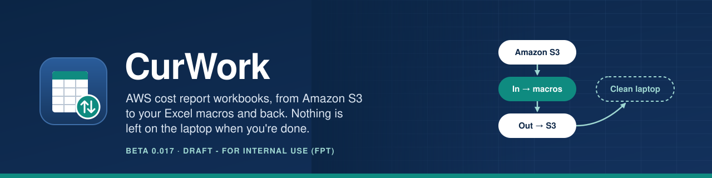
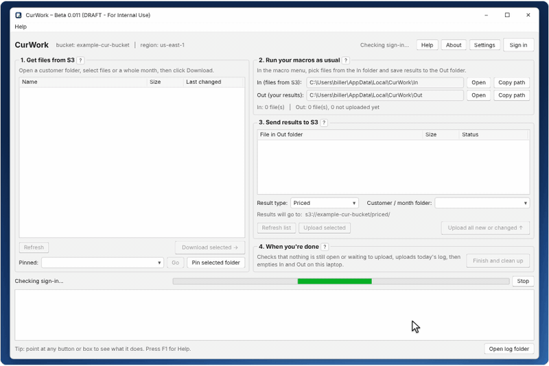

<p align="center">
  
</p>

<!-- These badges are fixed images. Update the numbers here when they change. -->
<p align="center">
  
  
  
  
  
  
  
  
  
  
</p>

<p align="center">
  <a href="#watch-the-demo"><b>Watch the demo</b></a> &nbsp;·&nbsp;
  <a href="WINDOWS.md"><b>Windows 11 guide</b></a> &nbsp;·&nbsp;
  <a href="CurWork-app/ADMIN_AND_SECURITY_GUIDE.md"><b>Admin and security guide</b></a> &nbsp;·&nbsp;
  <a href="SECURITY.md"><b>Report a security problem</b></a> &nbsp;·&nbsp;
  <a href="LICENSE"><b>License</b></a>
</p>

# CurWork

> **This is FPT's private software. Copyright (c) 2026 FPT. All rights reserved.** Only people FPT has approved may use it. It comes with no warranty. The [LICENSE](LICENSE) file has the full terms.
>
> **DRAFT - For Internal Use (FPT)** · Version **Beta 0.013** · Updated 2026-11-22 23:56 UTC · Modified by: mbitar

CurWork is a small desktop app for the billing team. It does four things:

1. It downloads AWS cost report workbooks from Amazon S3 to the biller's laptop.
2. The biller runs their usual Excel macros on those files. The macros don't change.
3. It saves the results in S3.
4. It deletes the files from the laptop when the biller is done.

| At a glance | |
|---|---|
| **Who it's for** | Billers. Admins and IT set it up. |
| **Runs on** | Windows 11 (the target). It also runs on a Mac, which is how we test it. |
| **Sign-in** | Your normal company sign-in with MFA, through AWS IAM Identity Center. No passwords or keys are saved. |
| **What billers can touch** | Only CurWork's folders in one S3 bucket. They can't delete anything. |
| **Left on the laptop afterwards** | Nothing. **Finish and clean up** empties the work folders. |
| **Tested** | 71 automated tests, plus permission checks against real AWS. Windows testing is waiting for approval. |

**Contents:** [Watch the demo](#watch-the-demo) · [How it works](#how-it-works) · [Security came first](#security-came-first) · [What's in this repository](#whats-in-this-repository) · [For billers](#for-billers) · [For admins](#for-admins) · [Testing on a Mac](#testing-on-a-mac) · [Testing on Windows 11](#testing-on-windows-11) · [Keeping AWS details out of GitHub](#keeping-aws-details-out-of-github) · [License and disclaimers](#license-and-disclaimers) · [Where things stand](#where-things-stand)

## Watch the demo

<a href="docs/demo/curwork-demo.html"></a>

This loop plays a whole biller session at 2.5 times normal speed. The full demo, with captions, chapters and pause buttons, is [docs/demo/curwork-demo.html](docs/demo/curwork-demo.html). GitHub shows that page's code instead of playing it, so download the file and open it in a web browser. The demo uses made-up sample data.

## How it works

To set CurWork up, test it and run it on Windows 11, follow [WINDOWS.md](WINDOWS.md).


## Security came first

CurWork handles cost data for federal agency customers, so we designed it around security from day one. We didn't bolt it on later. Every decision aimed to keep data from leaking, stop mistakes from changing the wrong files, and give an attacker as little as possible to work with.

Here's what that means in practice. The last column lists the matching controls from NIST SP 800-53 Rev. 5, the US government's security control catalog. We also followed the AWS Well-Architected Framework (Security Pillar) and the CIS AWS Foundations Benchmark for the S3 and sign-in settings. The [Admin and Security Guide](CurWork-app/ADMIN_AND_SECURITY_GUIDE.md) has the full details.


| What we wanted | What CurWork does | NIST controls |
|---|---|---|
| **Give people only the access they need** | A biller can only see CurWork's folders, only download from the input folder, and only upload to the results and logs folders. They can't delete anything or look at the rest of the bucket. Our automated tests check this against real AWS every time they run. | AC-3, AC-6 |
| **Never store passwords or keys** | People sign in with their normal company sign-in, including their company's multi-factor step. AWS hands out short-lived access that expires on its own (after 8 hours in our tests). CurWork never asks for, saves or logs a password, key or token. | IA-2, IA-5, AC-12 |
| **Encrypt everything** | The S3 bucket only accepts secure (TLS 1.2 or newer) connections and encrypts every file it stores. Admins can also switch on AWS's FIPS-validated connections. | SC-8, SC-13, SC-28 |
| **Lock down the storage** | Public access to the bucket is blocked. It keeps old copies when a file is replaced, and deletes those old copies after 30 days. | AC-3, CM-6, CP-9 |
| **Don't leave data on laptops** | Files are only on the laptop between download and "Finish and clean up", which empties the work folders. CurWork also warns you if the work folder is inside OneDrive, Box, Dropbox, Google Drive or iCloud Drive, because those would copy the files off the laptop. | MP-6, SC-28, AC-3 |
| **Never change files by surprise** | Every upload is checked with a SHA-256 fingerprint and its size. Downloads only replace a file once they've fully arrived. CurWork asks before replacing a file in S3, or a downloaded file you've edited. | SI-7, SI-10 |
| **Keep risky settings with the admin** | The bucket, folders, encryption and sign-in settings sit in an admin file that users can't change. Users can only change a few harmless preferences, like their pinned folders. The built app only reads the admin file installed next to it, so nobody can point it at a different one. | CM-5, CM-6, CM-7 |
| **Check every file name and path** | CurWork refuses any file name or folder path that could write outside its own folders, and only uploads to the folders the admin allows. | SI-10, AC-3 |
| **Keep a record** | Each session writes a log of who did what and where, without any secrets. The log goes to S3 when the biller finishes. When AWS refuses something, the message says exactly what was refused. | AU-2, AU-3, AU-9, AU-12 |
| **Show a warning banner if needed** | Admins can turn on a "system use" notice that users must accept when CurWork starts. | AC-8 |
| **Trust only known building blocks** | Every Python package CurWork uses is locked to an exact version and fingerprint. Each Windows build runs all the tests, stops if any package has a known security hole, and writes a list of everything inside it (an SBOM). | SR-3, SR-4, RA-5, SI-2, CM-14 |
| **Test it like an attacker would** | Besides the normal tests, we test against real AWS to prove billers can't do what they shouldn't. Nobody tests by hand until every automated test passes. | SA-11, CA-2 |
| **Keep AWS details out of the code** | Account numbers, sign-in addresses and profile names live in one private file that's never uploaded. Git checks block any upload that contains them. | AC-22, IA-5 |

This table describes how we built and tested CurWork. It isn't a certification or approval under NIST, FedRAMP or any other program. To report a security problem, see [SECURITY.md](SECURITY.md).

## What's in this repository

```
CurWork-app/            The app itself
  curwork.py                   The window
  curwork_core.py              S3, sign-in, settings and file handling
  curwork_help.py              The tips and Help text
  assets/                      The app icon
  iam/                         The AWS permission policies for billers and the bucket
  tests/                       Automated tests
  build_exe.ps1                Builds CurWork.exe on a Windows machine
  README.md                    The full app guide
  ADMIN_AND_SECURITY_GUIDE.md  Setup and security guide for admins
WINDOWS.md                     How to set up, test and run CurWork on Windows 11
run_windows_tests.ps1          Runs all the automated tests on Windows
CurWork_Test_Menu.command      The Mac test menu (start here to test)
*.command                      The test scripts the menu runs
tools/                         Helper scripts used by the tests
sample-data/                   Made-up cost report workbooks (no real customer data)
curwork_test.env.example       Template for your private test settings
.githooks/                     The checks that stop AWS details being uploaded
docs/diagrams/                 The diagrams in this README
docs/demo/                     The animated demo (web page and a short loop)
docs/brand/                    The banner and the GitHub social preview image
```

Some files are never uploaded to GitHub. The `.gitignore` file keeps them out:

- the laptop settings file, because it names the real sign-in setup;
- your private test settings file (`curwork_test.env`);
- each user's own preferences;
- test results and logs;
- the built app (`CurWork.app` and `CurWork.exe`) and the Python setup folder (`.venv`);
- the 116 MB test workbook, because GitHub won't take files over 100 MB. You can make it again with `tools/make_large_sample.py`.

## For billers

The [animated demo](docs/demo/curwork-demo.html) plays these steps from start to finish. It uses made-up sample data.

1. Start CurWork and click **Sign in**. Finish signing in in your browser.
2. **Step 1:** open a customer folder, pick a month or some files, and click **Download selected**.
3. **Step 2:** run your macros as usual. Open the files from the **In** folder and save the results to the **Out** folder.
4. **Step 3:** check the result type and the customer/month folder, then click **Save all new or changed in S3**.
5. **Step 4:** close the files in Excel and click **Finish and clean up**.

If you're not sure what something does, point at it to see a tip, click the **?** next to a step, or press **F1** for Help. The full guide is [CurWork-app/README.md](CurWork-app/README.md).

## For admins

Read the [Admin and Security Guide](CurWork-app/ADMIN_AND_SECURITY_GUIDE.md). It covers the S3 bucket and folders, the biller permissions (the files are in [iam/](CurWork-app/iam/)), the admin settings file, how to roll CurWork out, and how each security control is met.

## Testing on a Mac

The Mac test kit tests CurWork against a real AWS test account, signed in with the same limited access billers get. It's only for testing. Never give these scripts to billers.

**The first time, after you download the repository:**

1. Install Python 3.10 or newer and the AWS CLI version 2. Don't use the Python 3.9 that comes with macOS.
2. Make a copy of `curwork_test.env.example` called `curwork_test.env`. Fill in your test account number, your admin AWS CLI profile, your company's AWS sign-in address and its Region. This file stays on your Mac and is never uploaded.
3. Turn on the upload checks by running `git config core.hooksPath .githooks`.
4. You don't need the admin settings file for testing. Menu option 3 makes a test one for you. For real use, get the file from your admin.

**After that, double-click `CurWork_Test_Menu.command`.** Under each option the menu tells you when to use it, what it does, what it changes, and whether it passed last time.

| # | Option | What it does |
|---|---|---|
| 1 | Check this Mac | Checks that Python, the window toolkit and the AWS CLI work, installs what CurWork needs, and runs the tests |
| 2 | Clean up old test items | Finds everything earlier tests left behind, even after a crash. You choose what to delete, then type **confirm** |
| 3 | Create the test bucket | Makes a locked-down test bucket, uploads the sample files, points CurWork at it, and then does option 4. It checks everything at the end |
| 4 | Set up biller test access | Gives you a test sign-in with the same limited access billers get, so you can test exactly what they'd see |
| 5 | Upload the large sample | Puts the 116 MB, 3.2-million-row test workbook into the test bucket |
| 6 | Check why something is refused | Changes nothing. Shows which permissions the test sign-in has and exactly what AWS refuses |
| 7 | Build and open CurWork.app | Builds the Mac app with its own name and icon. It only opens the app if the app's self-check passes |
| 8 | Run all automated tests | Runs every automated check, including real AWS tests and the check for AWS details in the code. **Run this before you test anything by hand.** |
| 9 | Start CurWork from source | Starts CurWork straight from the code, without building the app |
| 10 | Clean up when finished | The same as option 2 |
| 11 | Reset everything | Deletes every test item, then does option 3 again |

Every script that creates or deletes anything in AWS asks you to type **confirm** first, and then checks that it worked. Most scripts save what happened in a file ending in `_results.txt`, which is never uploaded.

## Testing on Windows 11

[WINDOWS.md](WINDOWS.md) takes you from a fresh Windows 11 PC to a tested `CurWork.exe`: the tools to install, your private test settings, the build, the automated tests (`run_windows_tests.ps1`) and a checklist for testing by hand. It uses the test bucket and biller test sign-in made by the Mac test kit.

**Windows testing hasn't been done yet. It's waiting for approval.**

## Keeping AWS details out of GitHub


Your account number, sign-in address and profile names are only stored in `curwork_test.env`, which never leaves your Mac. Before every commit and every upload to GitHub, a check (`tools/check_no_aws_details.sh`) looks for AWS account numbers, AWS sign-in addresses, email addresses, access keys, private keys, and anything from `curwork_test.env`. If it finds any, it stops the upload and tells you which file to fix. Menu option 8 runs the same check. This follows NIST SP 800-53 control AC-22, which is about keeping sensitive details out of public places.

## License and disclaimers

- **It's private.** CurWork belongs to FPT. Only people FPT approves may use it, and only for FPT's own work. See the [LICENSE](LICENSE).
- **It's an early test version.** It isn't approved for real billing or financial reporting yet. Don't rely on it for that until FPT approves it.
- **There's no warranty.** Check every result yourself. FPT isn't responsible for errors or losses.
- **It isn't certified.** Mentions of NIST, FedRAMP or other standards describe how we designed it, not an official approval.
- **It isn't made by AWS, Microsoft or Apple.** Their product names are their trademarks.
- **It uses some open source parts.** Those parts keep their own licenses, listed in [THIRD_PARTY_NOTICES.md](THIRD_PARTY_NOTICES.md).

## Where things stand

This is Beta 0.013, a draft. We've tested it on a Mac against real AWS, signed in with the limited biller access, and all automated tests pass. We haven't tested it yet with the real Excel macros. Windows testing hasn't been done yet either. It's waiting for approval. The Windows scripts and steps are written and ready for when it's approved. The Admin and Security Guide lists the decisions that are still open.

---
*DRAFT - For Internal Use (FPT) · Beta 0.013 · Updated 2026-11-22 23:56 UTC · Modified by: mbitar*
