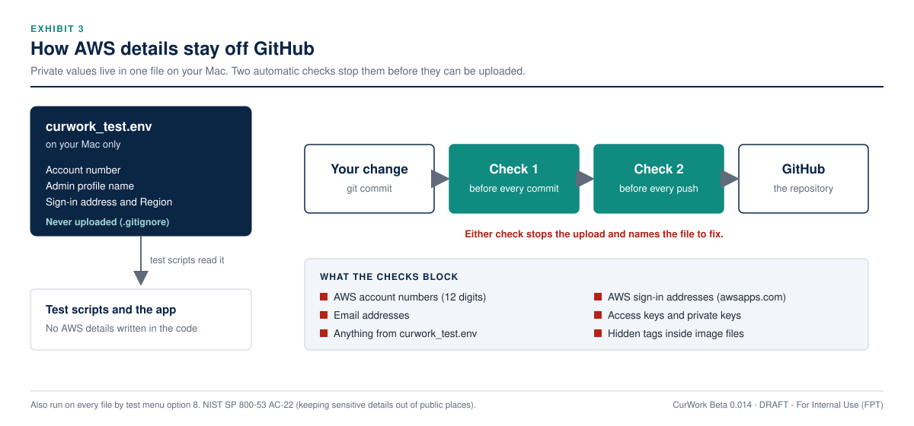

# Security policy

> **DRAFT - For Internal Use (FPT)** · Version **Beta 0.017** · Updated 2026-11-23 02:14 UTC · Modified by: mbitar

CurWork is FPT's private software. It moves cost data for federal agency customers between Amazon S3 and billers' laptops, so we designed it around security from the first day instead of adding security later. This document explains how to report a security problem, and then describes every security control in CurWork: who can do what, how the data is protected at each step, what is built into the app, what admins and IT must set up, how we test it, and which risks are still open.

The [README](README.md) gives a short overview, and the [Admin and Security Guide](CurWork-app/ADMIN_AND_SECURITY_GUIDE.md) has the step-by-step setup.

**Contents:** [Report a problem](#if-you-find-a-security-problem) · [At a glance](#security-at-a-glance) · [Sign-in and access](#sign-in-and-access) · [Data protection](#where-the-data-is-and-what-protects-it) · [Built into the app](#built-into-the-app) · [Settings](#who-controls-the-settings) · [Code and supply chain](#keeping-the-code-and-its-parts-safe) · [Testing](#how-we-test-security) · [Setup outside the app](#what-must-be-set-up-outside-the-app) · [NIST mapping](#nist-sp-800-53-mapping) · [Open risks](#risks-that-are-still-open)

## If you find a security problem

- Don't post it anywhere public. That means no GitHub issue, pull request or discussion, and nothing outside FPT.
- Tell the CurWork owner privately, through your manager or FPT's security contact.
- Say what you saw and how to make it happen again. Add the version details (in CurWork, open **About** and click **Copy details**) and the log file (open the **Activity** tab and click **Open log folder**). Take out any customer data first.
- If you think an AWS key, an account number or customer data got out, say that first, so access can be shut off quickly.

## Which versions get fixes

Only the latest build of Beta 0.017. Fixes go into the next build, so replace older builds rather than patching them.

## What this covers

- The CurWork app that billers use, and the CurWork Admin Settings app that admins use.
- The laptop settings file and the settings kept in AWS Parameter Store.
- The AWS permission policies in [`CurWork-app/iam/`](CurWork-app/iam/).
- The Windows build script, the Mac test scripts and the Git checks in this repository.
- The animated demo published at scriptbuzz.github.io/curworks. It uses made-up sample data only.

Please also report problems you find in AWS, Python or other parts CurWork uses, and we'll pass them on to whoever makes them.

## Security at a glance

The last column lists the matching controls from NIST SP 800-53 Rev. 5, the US government's security control catalog. We also followed the AWS Well-Architected Framework (Security Pillar) and the CIS AWS Foundations Benchmark for the S3 and sign-in settings.

| What we wanted | What CurWork does | NIST controls |
|---|---|---|
| **Give people only the access they need** | A biller can only see CurWork's folders, only download from the input folder, and only save in the results and logs folders. They can't delete anything or look at the rest of the bucket. Our automated tests check this against real AWS every time they run. | AC-3, AC-6 |
| **Never store passwords or keys** | People sign in with their normal company sign-in, including their company's multi-factor step. AWS hands out short-lived access that expires on its own (after 8 hours in our tests). CurWork never asks for, saves or logs a password, key or token. | IA-2, IA-5, AC-12 |
| **Encrypt everything** | The S3 bucket only accepts secure connections (TLS 1.2 or newer) and encrypts every file it stores with a customer-managed key. Admins can also switch on AWS's FIPS-validated connections. | SC-8, SC-13, SC-28 |
| **Lock down the storage** | Public access to the bucket is blocked. The bucket keeps old copies when a file is replaced, and deletes those old copies after the admin's retention period (30 days in the test bucket). | AC-3, CM-6, CP-9 |
| **Don't leave data on laptops** | Files are only on the laptop between download and **4. Finish and clean up**, which empties the work folders. CurWork warns if the work folder is inside OneDrive, Box, Dropbox, Google Drive or iCloud Drive, because those would copy the files off the laptop. | MP-6, SC-28, AC-3 |
| **Never change files by surprise** | Every file saved in S3 is checked with a SHA-256 fingerprint and its size. Downloads only replace a file once they've fully arrived. CurWork asks before replacing a file in S3, or a downloaded file you've edited. | SI-7, SI-10 |
| **Keep risky settings with the admin** | The bucket, folders and encryption settings are kept in AWS Parameter Store, and only the AWS admin role can change them. The laptop settings file holds only the sign-in settings, and the built app only reads the copy installed next to it. Billers' copy of CurWork doesn't contain the admin app at all. | CM-5, CM-6, CM-7 |
| **Check every file name and path** | CurWork refuses any file name or folder path that could write outside its own folders, and only saves in the folders the admin allows. | SI-10, AC-3 |
| **Keep a record** | Each session writes a log of who did what and where, without any secrets. The log is saved in S3 when the biller finishes. AWS CloudTrail is the official record of every download and save. | AU-2, AU-3, AU-9, AU-12 |
| **Show a warning notice if needed** | Admins can turn on a "system use" notice that users must accept when CurWork starts. | AC-8 |
| **Trust only known building blocks** | Every Python package CurWork uses is locked to an exact version and fingerprint. Each Windows build runs all the tests, stops if any package has a known security hole, and writes a list of everything inside it (a software bill of materials, or SBOM). | SR-3, SR-4, RA-5, SI-2, CM-14 |
| **Test it like an attacker would** | Besides the normal tests, we test against real AWS to prove that billers can't do what they shouldn't. Nobody tests by hand until every automated test passes. | SA-11, CA-2 |
| **Keep AWS details out of the code** | Account numbers, sign-in addresses and profile names live in one private file that's never uploaded. Git checks block any upload that contains them. | AC-22, IA-5 |

## Sign-in and access

### How people sign in

- Billers and admins sign in with their company account through AWS IAM Identity Center, which connects to the company's Microsoft Entra ID. The company's multi-factor sign-in step applies.
- CurWork opens the sign-in page in the web browser. The password and the multi-factor code are typed into the browser only; CurWork never sees them.
- AWS gives the AWS command line tool on the laptop short-lived access, which CurWork uses. The admin sets how long it lasts in the permission set, from 1 to 12 hours. With 8 hours or more, one sign-in covers a workday.
- No AWS access keys exist for billers, and none are stored anywhere on the laptop. When the access expires, CurWork says so and asks the biller to sign in again. Nothing that was downloaded is lost.

### What a biller is allowed to do

The biller permission set ([`iam/biller_permission_set_policy.json`](CurWork-app/iam/biller_permission_set_policy.json)) allows exactly what the four steps need, and nothing else:

| Permission | What it allows | Why CurWork needs it |
|---|---|---|
| List the bucket, only inside CurWork's folders | See the folders and files in `converted/`, the result folders (`priced/`, `allocated/`, `mapped/`, `split/`, `reports/`) and `logs/` | To show the Files in S3 list, and to check whether a result is already in S3 before asking **Replace** or **Skip** |
| Read `converted/` | Download the input workbooks | Step 1, Download from S3 |
| Save and read the result folders and `logs/` | Save results and the day's log, and read them back | Step 3, Save in S3, and confirming each saved file |
| Use the bucket's encryption key | Decrypt downloads and encrypt saved files | Every file in the bucket is encrypted with this key |
| Read the CurWork settings in Parameter Store | Read the parameters under `/curwork/` | CurWork reads the bucket, folders and rules after sign-in |

There is no delete permission. A biller can't remove a file, and when a biller replaces a result, S3 keeps the old copy. A biller also can't change the settings in Parameter Store, the bucket policy or any permission.

### Who can change the settings

- Only the AWS admin role can save the settings in Parameter Store. The biller permission set can only read them.
- Admins use the CurWork Admin Settings app, a separate app (`CurWork Admin.app` on a Mac, `CurWorkAdmin.exe` on Windows). It checks every value with the same rules CurWork uses, lists each change and asks the admin to confirm it before saving.
- If a biller's sign-in tries to save, AWS refuses it, and the app says that only the AWS admin role can change the settings. The app doesn't decide this itself; AWS does.
- If another admin saved a newer version after you loaded the settings, nothing is saved, so one admin can't overwrite another admin's change by accident.
- Parameter Store keeps every saved version, and CloudTrail records who saved each one.

## Where the data is and what protects it

| Stage | Where the data is | What protects it |
|---|---|---|
| Stored | The S3 bucket | Encryption with a customer-managed AWS KMS key (SSE-KMS), Block Public Access, ACLs turned off, S3 Versioning, no delete for billers, CloudTrail data events |
| Moving | Between S3 and the laptop | TLS 1.2 or newer, enforced by the bucket policy ([`iam/bucket_policy_additions.json`](CurWork-app/iam/bucket_policy_additions.json)); FIPS endpoints can be turned on for the AWS side |
| Downloading | The In folder | The file is written as a temporary `.part` file and renamed only when its size matches S3, so a broken download never looks complete |
| Working | The In and Out folders | BitLocker disk encryption on the laptop; Excel works on local copies only |
| Saving in S3 | From the Out folder to S3 | S3 checks a SHA-256 checksum that CurWork sends, then CurWork confirms the size in S3; files open in Excel are never saved |
| After the session | The laptop | **4. Finish and clean up** empties In and Out; files left behind are flagged when CurWork closes and the next time it starts |

## Built into the app

- **Temporary access only.** CurWork uses the short-lived sign-in from the AWS command line tool. It never asks for, stores or writes a password, key or token, including in its log.
- **Inputs are read-only.** CurWork downloads only from `converted/` and saves only in the result folders the admin allows. It refuses to save results in `converted/` even before AWS would refuse it.
- **Safe file names.** S3 file names are checked before they become file names on the laptop. Names that use `..` to climb out of a folder, or that Windows doesn't allow, are refused, so nothing can be written outside the work folder.
- **No planted programs.** CurWork never runs an `aws.exe` from the current folder, so a program dropped next to a workbook can't be run in its place. The admin can fix the AWS command line tool's path.
- **No command shell.** CurWork starts the AWS command line tool and the folder viewer with a fixed list of arguments and no command shell, so file names can't be turned into commands.
- **Open files are protected.** A file that is open in Excel is never saved in S3, replaced or deleted.
- **Cloud-sync warning.** CurWork warns if the work folder is inside OneDrive, Box, Dropbox, Google Drive or iCloud Drive.
- **Asks before replacing.** CurWork asks before replacing a file in S3, and before replacing a downloaded file that the biller has changed.
- **Optional use notice.** The admin can turn on a notice that the biller must accept before CurWork starts.
- **Least functionality.** Billers' copy of CurWork is built without the admin app's code. Its Settings tab shows the admin settings read-only, and the shared form contains no code that saves anything.
- **Plain error messages.** When AWS refuses something, CurWork says what was refused, for example a download, so problems are reported accurately instead of being hidden.

## Who controls the settings

| Settings | Where they are | Who can change them |
|---|---|---|
| How to sign in, the Region, the FIPS switch, the AWS command line tool's path, the use notice and the Parameter Store name | The laptop settings file, `curwork_admin_settings.json`, installed next to CurWork | The admin, by installing the file in a folder billers can't change |
| The bucket, encryption key, folders, result types, file types, work folder, log folder and the other managed settings | AWS Parameter Store, `/curwork/admin-settings` | Only the AWS admin role, with the CurWork Admin Settings app |
| Pinned folders, recent folders, the last result type, window size and column widths | The user preferences file | Each biller, on the **Settings** tab under **My preferences** |

- **Config lock.** The built app only reads the laptop settings file installed next to it. It ignores the `--config` option and the `CURWORK_CONFIG` environment variable, so nobody can point it at a different file.
- **Sign-in only on the laptop.** CurWork refuses a laptop settings file that contains the bucket or any other setting that belongs in Parameter Store. It also ignores laptop-only settings found in Parameter Store and writes a warning to the log.
- **No S3 until the settings arrive.** CurWork doesn't use S3 at all until it has read the managed settings from Parameter Store after sign-in.
- **Preferences can't change security.** The user preferences file can only hold the harmless preferences above. Anything else in it is ignored, and the file has a size limit.

## Keeping the code and its parts safe

**AWS details stay out of the code**
- Account numbers, the admin profile name and the sign-in address live in one private file, `curwork_test.env`, which Git never uploads.
- Two Git checks run automatically, one before every commit and one before every push. Either check stops the upload and names the file to fix. Test menu option 8 runs the same check on every file.
- The checks block AWS account numbers (12 digits), AWS sign-in addresses, email addresses, access keys, private keys, anything from `curwork_test.env`, and hidden tags inside image files.
- The laptop settings file, each user's preferences, test results and the built apps are never uploaded.

**The parts CurWork is built from**
- Every Python package that ships inside CurWork is locked to an exact version and checked against its SHA-256 fingerprint when it's installed.
- Every Windows build runs all the tests, checks every installed package for known security holes with pip-audit, and stops if anything fails.
- Every build writes a software bill of materials (`sbom-runtime.cdx.json`, CycloneDX format) that lists everything inside it.
- Both built apps run a self-test before the build is accepted. CurWork's self-test also confirms that it doesn't contain the admin app.
- The built apps must be signed with the company code-signing certificate before anyone uses them, and IT should allow only the signed apps to run.
- The licences of the software CurWork uses are in [THIRD_PARTY_NOTICES.md](THIRD_PARTY_NOTICES.md).

## How we test security

- **121 automated tests** run with a mocked AWS. They include window tests that drive the real CurWork window through sign-in, browsing, downloads, saving in S3, refusals, Settings and Finish, and a check that every AWS call CurWork makes fits inside the biller permission set.
- **26 checks against real AWS** run on every full test run, signed in with a test biller permission set built from the real policy. They prove, among other things, that:
  - AWS refuses a biller writing to `converted/`, deleting a result and listing the whole bucket;
  - CurWork refuses to save results in `converted/` before AWS is even asked;
  - only the admin role can save the settings in Parameter Store, a biller's save is refused and changes nothing, and Parameter Store records who saved each version;
  - CurWork signs in with the role named in its settings and reads its settings from Parameter Store.
- **Security scans.** pip-audit found no known security holes in the packages. bandit, a Python security scanner, found no medium or high findings; the low findings are expected, because CurWork starts the AWS command line tool and the folder viewer with fixed arguments and no shell.
- **Hand tests come last.** Nobody tests by hand until every automated test passes.
- **Not yet done:** a run on a Windows biller laptop with real Excel, and a test with the real (not test) biller permission set. Windows testing is waiting for approval.

## What must be set up outside the app

**In AWS (the AWS admin)**
- The biller permission set from [`iam/biller_permission_set_policy.json`](CurWork-app/iam/biller_permission_set_policy.json), with its session length, assigned to the billers' group.
- The bucket: Block Public Access on, ACLs off, S3 Versioning on with a lifecycle rule for old versions, default encryption with the customer-managed KMS key, and the statements in [`iam/bucket_policy_additions.json`](CurWork-app/iam/bucket_policy_additions.json), which refuse any request without TLS or with TLS older than 1.2.
- Optional: allow access only from the company VPN or a VPC endpoint.
- CloudTrail data events (reads and writes) for the bucket, sent to the SIEM, and alerts on changes to the bucket policy, the KMS key policy and the biller permission set.
- Permission to save the CurWork parameter in Parameter Store for the AWS admin role only.

**On the laptops (IT)**
- BitLocker disk encryption and the screen lock.
- The signed CurWork app and its laptop settings file in a folder billers can read but not change, such as `C:\Program Files\CurWork`.
- AppLocker or WDAC rules that allow only the signed app.
- If a proxy inspects HTTPS traffic, handle AWS traffic without turning off certificate checks.
- Billers get CurWork only. The CurWork Admin Settings app is for admins.

## NIST SP 800-53 mapping

| Control | What covers it | Where | Status |
|---|---|---|---|
| AC-3, AC-6 Least privilege | The permission set lists only the CurWork folders, reads `converted/`, saves in the result folders and `logs/`, and can't delete. CurWork also refuses saves outside the result folders. | AWS + app | Met |
| AC-8 Use notice | Optional use notice; the biller must click OK to continue | App | Met if turned on |
| AC-11 Idle lock | The Windows screen lock and the sign-in expiry; CurWork has no lock of its own | Laptop | By design |
| AC-12 Session end | The permission set's session length (1 to 12 hours) | AWS | Met |
| AC-22 Public content | Git checks keep AWS details out of the public repository | Repository | Met |
| AU-2, AU-3, AU-12 Audit events | CloudTrail data events for every S3 read and write, sent to the SIEM; CurWork's log of actions and file names | AWS + app | Met |
| AU-9 Protect audit data | Billers can edit the local log, so CloudTrail is the official record | AWS | By design |
| AU-10 Proof of who did it | Identity comes from Identity Center and CloudTrail; the Windows user name in logs and S3 metadata is for convenience only | AWS | By design |
| CM-5, CM-6 Configuration control | Sign-in settings in Program Files; all other settings in Parameter Store, which only the AWS admin role can change; the config lock; preferences can't change either. IT must make the install folder read-only for billers. | IT + app | Met (app); IT to confirm folder permissions |
| CM-7 Least functionality | Billers' CurWork is built without the admin app; the read-only Settings tab has no save code | App | Met |
| CM-14, SI-7(15) Signed software | Sign both apps before deployment and allow only the signed apps | IT | Process |
| CP-9 Backup | S3 Versioning keeps every replaced copy for the retention period | AWS | Met |
| IA-2 Multi-factor sign-in | Entra sign-in with MFA through IAM Identity Center | Entra + AWS | Met |
| IA-5 Authenticators | No access keys; short-lived access and a sign-in cache that both expire | AWS command line tool | Met |
| MP-6 Media sanitization | Deleting from an SSD isn't sanitization, so BitLocker protects the copies | Laptop | Needs BitLocker |
| RA-5, SI-2 Vulnerabilities and patching | pip-audit in every build; keep Python and the AWS command line tool patched | Build + IT | Process |
| SA-11, CA-2 Developer testing | 121 automated tests and 26 real AWS checks on every full test run | Build | Met |
| SC-8 Encryption in transit | TLS everywhere; the bucket policy refuses requests without TLS or with TLS older than 1.2 | AWS | Met |
| SC-13 Validated cryptography | FIPS endpoints are available on the AWS side. The laptop end uses the OpenSSL that ships with Python, which isn't a FIPS-validated module. | App | Open |
| SC-28 Encryption at rest | SSE-KMS on the bucket, BitLocker on the laptop | AWS + laptop | Met |
| SI-7 Integrity | SHA-256 checksum and size check on every save; downloads renamed only when complete | App + AWS | Met |
| SI-10 Input checks | S3 file names and destination folders are checked; settings files are size-limited and checked | App | Met |
| SR-3, SR-4 Supply chain | Packages locked with hashes, an SBOM for every build, pip-audit in every build | Build | Met |

## Risks that are still open

- **Laptop-side FIPS (SC-13).** The secure connection from the laptop doesn't use a FIPS-validated module. If the data or the contract needs it, the options are: send S3 traffic through the agency's FIPS-validated VPN, build Python with a FIPS-validated OpenSSL 3 provider, or rewrite the transfer part in .NET so Windows' own cryptography handles it with Windows FIPS mode on.
- **Editable local logs.** Billers can edit the log on their laptop. CloudTrail is the official record.
- **No check-out lock between billers.** Two billers could save the same result. S3 Versioning keeps every replaced copy.
- **Data on the laptop during a session.** Customer files are on the laptop between download and finish. BitLocker and **4. Finish and clean up** limit this.
- **Shared preferences file.** When preferences are kept next to CurWork, everyone who uses that laptop shares the file, and it can name customers in the recent and pinned folders. The admin can keep preferences in each biller's work folder instead.
- **Decisions still to make:** confirm that Entra connects through IAM Identity Center, choose the Windows packaging, confirm how the proxy treats AWS traffic, and decide who can read and write each settings file.

## What we promise

- Limited access, encryption and no stored passwords or keys are requirements. They're never optional.
- Every build checks the Python packages for known security holes, and lists everything that's inside it.
- AWS account numbers, sign-in addresses and keys stay out of the code, and checks block them from being uploaded.

This document describes how we built and tested an early internal version of CurWork. It isn't a certification or approval under NIST, FedRAMP or any other program.

---
*DRAFT - For Internal Use (FPT) · Beta 0.017 · Updated 2026-11-23 02:14 UTC · Modified by: mbitar*
